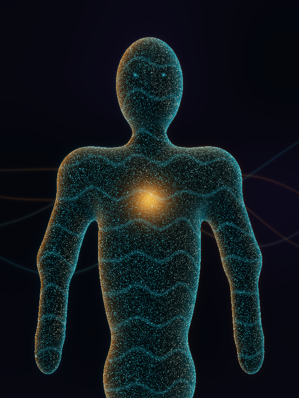
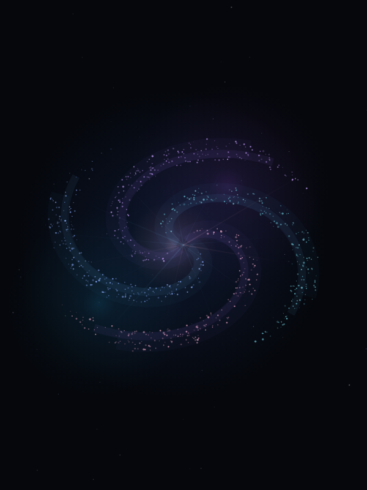

# Avalon by ProgreTech

### Your AI, here with you.

A living wallpaper and desktop control panel for Ubuntu. **Avalon is a nice-to-have companion for your AI tools**: a place to see activity, switch your selected model, chat, and optionally talk to an animated presence on your desktop.

Use **OpenCode with Ollama** for local models by default, or switch to **Codex** or **Claude Code** using that CLI's own configured provider and model. One selected runtime gives the wallpaper its presence at a time.

Built by [ProgreTech LLC](https://github.com/progretech-llc) as an open-source showcase of local AI, desktop interaction and practical interface design. Your agent tools work independently of Avalon.

  
  
  

<em>Actual renderer previews. Animation responds to session activity, speech and camera attention when enabled.</em>

[Install from source](docs/INSTALL.md) · [License](LICENSING.md) · [Current qualification](docs/PHASE-5.md) · [ProgreTech projects](https://github.com/progretech-llc)

## What it adds

- **A living desktop.** Humanoid, sentinel, Progre, abstract-core and galaxy appearances react to listening, reasoning/work, execution, speech and completion states. Avalon/status text and a wake/sleep button stay on the desktop.
- **A model and session controller.** Choose an installed Ollama model for OpenCode, return to conversations, or select a native Codex/Claude connection. Changing the appearance keeps the same conversation.
- **Optional local voice and vision.** Whisper recognition, Kokoro or Piper speech, voice style/pitch controls, wake phrases and engaged follow-up listening. Camera attention steers the avatar; image questions go to the selected model when it supports images.
- **A digital-body control panel.** LampOS-backed music playback, selected-output volume, device controls and native Harness pairing. Successful remote task completion is still being qualified.
- **A galaxy when you want one.** Avalon's Constellation appearance has its own settings, speech-driven glow and camera-driven positioning. The standalone [Constellation app](https://github.com/progretech-llc/constellation) remains independent. Only one wallpaper renderer can be active.

## Choose your connection

| Connection | Model/provider | Current evidence |
| --- | --- | --- |
| OpenCode + Ollama | Installed local Ollama models selected in Avalon | Local text, vision-capable model and voice flows exercised on the development workstation |
| Codex | Codex's own configured model, provider and authentication | Native connection and a real reply verified |
| Claude Code | Claude's own configured model, provider and authentication | Bridge connects; the workstation's configured model did not complete the qualification turn |

Ollama is the default local route through OpenCode. Selecting Codex or Claude does **not** force it through Ollama; local-provider support depends on that tool's configuration. Native runtimes retain their own tools and execution behavior. Hermes is not yet a qualified selectable route.

## Try it

Avalon is currently a **developer preview installed from source**, qualified on Ubuntu with GNOME Shell 50 and Wayland on x86_64. It is not yet a general-purpose Ubuntu package or an unattended installer for arbitrary desktops.

Start with [the installation guide](docs/INSTALL.md). It lists the existing CLI/model prerequisites, isolated Python environments, build/install commands and how to launch or stop Avalon. The installed **Project Avalon** shortcut opens the control panel. A normal logout/login loads changed GNOME extension JavaScript.

## You choose when it listens

Wake up enables the selected microphone, camera and spoken-output behavior together; Go to sleep releases Avalon's owned capture and playback. Device settings live in the panel. Locking the desktop stops media capture, and unlocking does not resume it automatically.

Speech stays local with Whisper/Kokoro/Piper. A camera image explicitly sent with a question goes to your selected model/provider; cloud runtime selection can therefore send that request off the machine. Session voice matching reduces accidental pickup; it is not identity authentication. Native CLI permissions still matter when allowing computer actions. See [current behavior and remaining checks](docs/PHASE-5.md).

## Development and status

The wallpaper, control panel, local speech/camera paths and runtime bridges are implemented. Long-session resource/lifecycle gates and successful live Harness worker completion remain open. Qualification records distinguish actual hardware checks from synthetic fixtures. Public source availability does not mean those gates are complete.

- [Product specification](docs/SPECIFICATION.md)
- [Delivery and qualification](docs/DELIVERY.md)
- [Native LampOS host](docs/LAMPOS.md)
- [Independent galaxy appearance](docs/CONSTELLATION.md)
- [Asset provenance](docs/ASSETS.md) and [third-party notices](THIRD_PARTY_NOTICES.md)

To report a problem, [open an issue](https://github.com/progretech-llc/project-avalon/issues) with your Ubuntu/GNOME version, selected runtime and reproducible steps. Remove chat history, camera/audio content and credentials from diagnostics.

## License and credits

Source code is **GPL-3.0-only**, with preserved MIT/Apache notices for compatible reused components. Named branded bitmap assets and supplied visual references have separate terms; see [LICENSING.md](LICENSING.md) and [ASSET-LICENSE.md](ASSET-LICENSE.md).

Built on [LampOS](https://github.com/autonomous-ai/lampOS), with scoped galaxy code from [Constellation](https://github.com/progretech-llc/constellation). ProgreTech, Progre and Avalon branding identify this project. Other product names belong to their respective owners; compatibility does not imply affiliation or endorsement.
